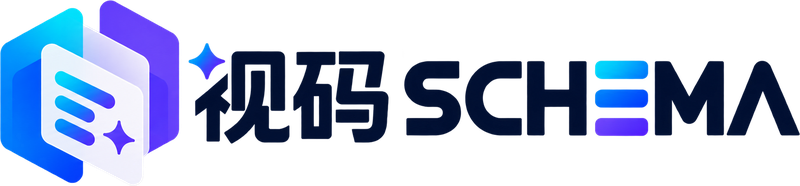

<p align="center"></p>

# 视码 SCHEMA · Portable Document Studio

将 ChatGPT 富内容回复保存为可移植文档，在多个项目中导入和渲染。当前版本 **2.2.13**，包含网站、Chrome 扩展、React SDK、开放格式、示例、测试和官方 Logo。

- 选择已加载回复，保存正文、图片、SVG 和可读取附件；导出文件名包含年月日与时分秒。
- 导入 `.schema.zip`，兼容历史 `.moyue.zip`，支持粘贴 Markdown 与富文本。
- 支持 KaTeX、Mermaid、Apache ECharts、地图、图库、通用列表、引用浮层、表单及分阶段 SVG。
- 提供浅色、深色及双主题参考页、版本化 JSON 格式与 JSON Schema。

## 本地开发

需要 Node.js 22 或更新版本。

```sh
npm ci
npm run dev
```

默认页面为参考回复；`/?view=import` 为文档工作台，`/?view=blocks` 为基础块检查。

## 验证与构建

```sh
npm test
npm run build:distribution
node scripts/verify-extension.mjs
node scripts/build-reference.mjs
npm run build
```

网站位于 `dist/`，可部署到支持 SPA 回退的静态托管服务。扩展、SDK、参考文档和源码压缩包生成在 `public/downloads/`，按上述顺序构建会一并复制到网站产物。生成文件不提交到 Git，均可从源码重建。GitHub Actions 会执行以上验证并保存构建产物 30 天。

解压 `public/downloads/schema-chrome-2.2.13.zip`，在 `chrome://extensions` 开启开发者模式并加载含 manifest.json 的目录。更新后重新加载扩展。

SDK 安装：`npm install ./public/downloads/moyue-document-kit-2.2.13.tgz`。

## 文档

- [接入指南](docs/INTEGRATION.md)
- [格式规范](docs/FORMAT.md)
- [通用布局和采集说明](docs/CONTENT-LAYOUT.md)
- [已知限制](docs/EXPORT-FIDELITY.md)
- [素材说明](ASSETS.md)

公开包名 `@moyue/document-kit`、文档内部 format 字段和存储键为兼容性标识，保持不变。

## 保存范围

扩展仅读取所选回复的公开 DOM，不访问 ChatGPT 私有接口、不上传聊天内容。跨站图片需按域名授权。未加载内容、隐藏状态、远程附件及自定义业务逻辑不保证能完整捕获；缺失会记录说明。旧包没有保存的数据无法凭空恢复，自动化 DOM 测试不能代替真实登录页面的视觉验收。参考页含模拟数据和重制示例，不代表真实研究结论。

## 目录

`src/` 网站与测试；`extension/` Chrome 插件；`packages/moyue/` SDK 与格式；`docs/` 规范；`scripts/` 构建；`public/brand/` 官方品牌；`vendor/open-intelligent-ui/` 保留许可的上游代码。

## 许可

代码采用 [MIT License](LICENSE)。上游和依赖保留各自许可，见 `vendor/open-intelligent-ui/LICENSE`、`public/OPENUI-LICENSE.txt` 和 `public/RENDERER-LICENSES.txt`。第三方照片、商标、截图与品牌标识不因代码采用 MIT 而获得额外授权。

上游完整源码归档以 vendor/upstream-source-archive 下的分块保存。npm run dev/build/build:distribution 会自动合并并验证 SHA-256，生成原 public/upstream-source.tar.gz 下载文件。也可单独运行 node scripts/restore-upstream.mjs。
